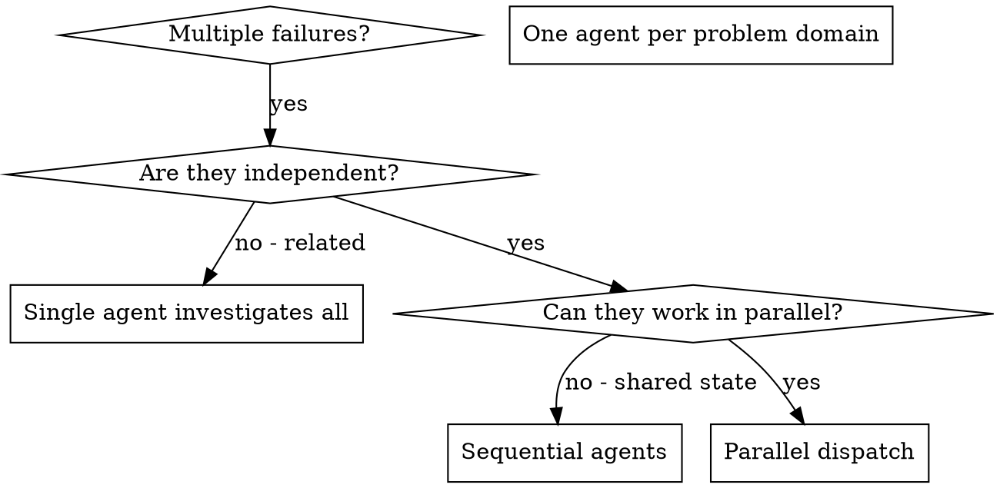

# 调度并行 Agent

## 概述

你把任务委派给具有隔离上下文的专用 Agent。通过精确设计它们的指令和上下文，确保它们保持专注并成功完成任务。它们绝不应继承你所在会话的上下文或历史——你需要精确构建它们所需的内容。这也能为你自己的协调工作保留上下文。

当你遇到多个互不相关的失败（不同测试文件、不同子系统、不同 bug）时，逐个排查会浪费时间。每次排查都是独立的，可以并行进行。

**核心原则：** 每个独立问题域调度一个 Agent，让它们并发工作。

## 何时使用



**使用场景：**
- 3 个以上测试文件失败，根因各不相同
- 多个子系统独立损坏
- 每个问题无需其他问题的上下文即可理解
- 各次排查之间无共享状态

**不使用场景：**
- 失败彼此相关（修好一个可能修好其他）
- 需要理解整个系统状态
- Agent 之间会相互干扰

## 模式

### 1. 识别独立问题域

按损坏内容对失败分组：
- 文件 A 测试：工具审批流程
- 文件 B 测试：批量完成行为
- 文件 C 测试：中止功能

每个问题域相互独立——修复工具审批不影响中止测试。

### 2. 创建聚焦的 Agent 任务

每个 Agent 获得：
- **明确范围：** 一个测试文件或子系统
- **清晰目标：** 让这些测试通过
- **约束条件：** 不要改动其他代码
- **预期输出：** 你发现并修复了什么的摘要

### 3. 并行调度

在同一响应中发出全部三个子 Agent 调度——它们会并行运行：

```text
Subagent (general-purpose): "Fix agent-tool-abort.test.ts failures"
Subagent (general-purpose): "Fix batch-completion-behavior.test.ts failures"
Subagent (general-purpose): "Fix tool-approval-race-conditions.test.ts failures"
# All three run concurrently.
```

一个响应中多次调度调用 = 并行执行。每个响应一次 = 顺序执行。

### 4. 审查与整合

Agent 返回后：
- 阅读每份摘要
- 验证修复之间无冲突
- 运行完整测试套件
- 整合所有改动

## Agent 提示词结构

好的 Agent 提示词应：
1. **聚焦** - 一个清晰的问题域
2. **自包含** - 包含理解问题所需的全部上下文
3. **明确输出** - Agent 应返回什么？

```markdown
Fix the 3 failing tests in src/agents/agent-tool-abort.test.ts:

1. "should abort tool with partial output capture" - expects 'interrupted at' in message
2. "should handle mixed completed and aborted tools" - fast tool aborted instead of completed
3. "should properly track pendingToolCount" - expects 3 results but gets 0

These are timing/race condition issues. Your task:

1. Read the test file and understand what each test verifies
2. Identify root cause - timing issues or actual bugs?
3. Fix by:
   - Replacing arbitrary timeouts with event-based waiting
   - Fixing bugs in abort implementation if found
   - Adjusting test expectations if testing changed behavior

Do NOT just increase timeouts - find the real issue.

Return: Summary of what you found and what you fixed.
```

## 常见错误

**❌ 范围过宽：** "修复所有测试"——Agent 会迷失方向
**✅ 具体明确：** "修复 agent-tool-abort.test.ts"——范围聚焦

**❌ 缺少上下文：** "修复竞态条件"——Agent 不知道在哪里
**✅ 提供上下文：** 粘贴错误信息和测试名称

**❌ 没有约束：** Agent 可能重构一切
**✅ 明确约束：** "不要改动生产代码"或"只修复测试"

**❌ 输出模糊：** "修好它"——你不知道改了什么
**✅ 输出具体：** "返回根因和改动的摘要"

## 何时不使用

**相关失败：** 修好一个可能修好其他——先一起排查
**需要完整上下文：** 理解问题需要查看整个系统
**探索性调试：** 你还不知道哪里坏了
**共享状态：** Agent 会相互干扰（编辑相同文件、使用相同资源）

## 会话中的真实案例

**场景：** 大规模重构后，3 个文件共 6 个测试失败

**失败情况：**
- agent-tool-abort.test.ts：3 个失败（时序问题）
- batch-completion-behavior.test.ts：2 个失败（工具未执行）
- tool-approval-race-conditions.test.ts：1 个失败（执行次数 = 0）

**决策：** 独立问题域——中止逻辑、批量完成、竞态条件彼此分离

**调度：**
```
Agent 1 → Fix agent-tool-abort.test.ts
Agent 2 → Fix batch-completion-behavior.test.ts
Agent 3 → Fix tool-approval-race-conditions.test.ts
```

**结果：**
- Agent 1：用基于事件的等待替换超时
- Agent 2：修复事件结构 bug（threadId 位置错误）
- Agent 3：增加等待异步工具执行完成

**整合：** 所有修复相互独立、无冲突，完整套件通过

## 验证

Agent 返回后：
1. **审查每份摘要** - 理解改动了什么
2. **检查冲突** - Agent 是否编辑了相同代码？
3. **运行完整套件** - 验证所有修复协同工作
4. **抽查** - Agent 可能犯系统性错误