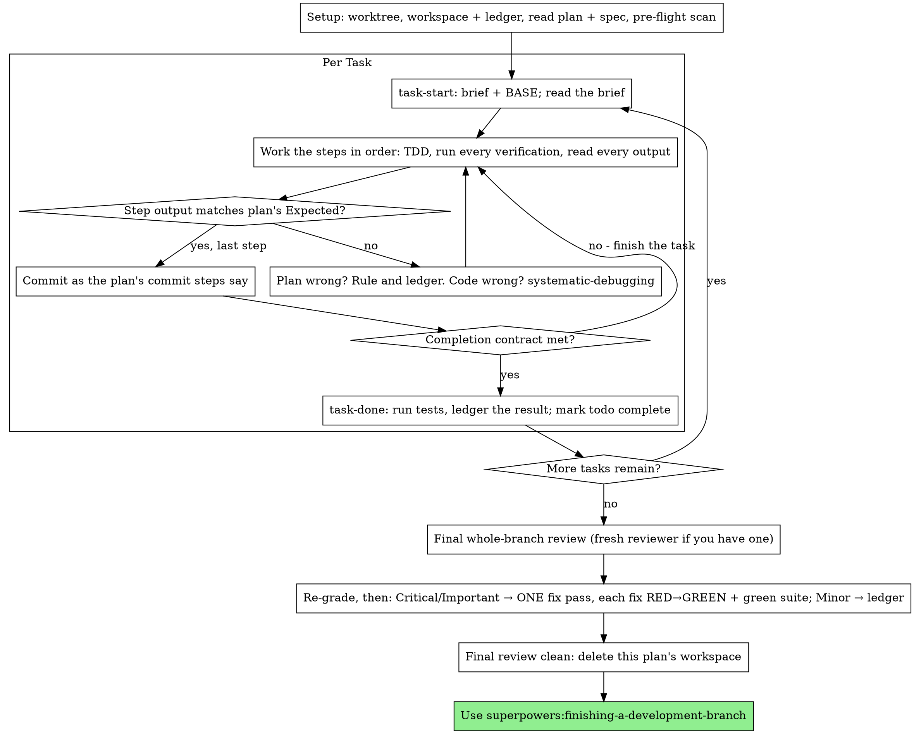

# 执行计划

在本会话中由你亲自逐任务执行计划：不设每任务的实现子代理，不设每任务的审查者。最后对整个分支做一次全新上下文的审查。

**为何内联：** 子代理驱动开发要为每个任务付出一个全新实现者和一个全新审查者的成本，二者都要从零重读代码库。内联执行只付出一个上下文（你的）加最后一名审查者。它放弃的是每任务的全新上下文和每任务的第二双眼睛。本技能用其他手段保住这两样东西带来的价值：简报即规格，台账即你的记忆，TDD 是每任务的关卡，最终审查者是第二双眼睛。

**核心原则：** 计划已经完成了思考。严格照做，用你亲眼看着先失败再通过的测试证明每一步，并留下能扛住你自己遗忘的记录。

**叙述：** 工具调用之间最多叙述一行短句——台账和工具结果承载记录。

**连续执行：** 任务之间不要停下来与搭档确认。他们选择内联执行是为了少花钱，不是为了在每个任务后回答"要不要继续？"。不停顿地执行计划中的所有任务。

**裁决，而非停滞。** 冲突、歧义、计划缺陷——由你决定。规格是约束性权威，计划是它的论证，你的判断裁定二者都未回答的问题。把每个决定记入台账：`Ruling: <你决定了什么> — <为什么> — <若错代价>`，然后继续。未经台账裁决就偏离计划，等于暗中做决定。

只有四件事能让你停下：不可逆或破坏性操作；安全敏感操作；本工作树之外、按惯例应先询问的副作用（合并、推送到共享分支、发布）；以及计划破碎到每条前路都是猜测。遇到这些，停下并询问。

## 何时使用

- 你有来自 superpowers:writing-plans 的计划，且搭档在交接时选择了内联执行。
- 你的运行环境没有子代理工具（见 `../using-superpowers/references/` 中的各平台参考）。绝不虚构派发；在此执行计划。
- 任务基本独立——与 superpowers:subagent-driven-development 相同的前提。

完全明确的计划使内联执行变成转录加测试：它在中等能力的会话模型上运行良好，而最强模型唯一值得付出成本的地方是最终审查，本技能单独派发它。搭档选择内联时告知他们这一点。

当搭档希望每个任务都有审查关卡，或计划长到后续任务会在压缩后的上下文上运行时，优先用 superpowers:subagent-driven-development。长计划上的内联执行仍可行——台账使其可恢复——但最后几个任务得到你最少的投入。

## 流程

## 准备

确保工作在隔离的工作树中进行：用 superpowers:using-git-worktrees 创建一个或验证现有的。未经搭档明确同意，绝不在 main/master 分支上开始实现。

对话记忆无法在压缩后存活。丢失位置的内联执行者会重新实现提交已存在的任务——与控制器重新派发它们相同的失败，代价是你的上下文。用台账文件跟踪进度，而不只是待办。运行环境的待办是实时视图；台账是记录。

工作区和台账与 superpowers:subagent-driven-development 共享——同一目录、同一格式——因此计划可在执行中途更换执行者，新执行者从同一台账恢复。

- 每个计划拥有一个工作区：技能开始时运行
  `../subagent-driven-development/scripts/sdd-workspace PLAN_FILE`——它打印计划的 git 忽略目录
  （`<repo-root>/.superpowers/sdd/<plan-basename>/`），是本计划所有产物的家：台账、简报、审查包。另一个计划的目录永远不归你读写。
- 在 `<workspace>/progress.md` 检查本计划的台账。若其首行指明你的计划文件，则带有 `Task <N>: complete` 行的任务已完成——不要重做；从第一个没有该行的任务恢复。即使你的上下文不再记得做过它们，它们的提交仍存在于 git 中：压缩后，信任台账和 `git log`，而非你自己的回忆。首行指明不同计划文件的台账是另一个计划的进度：别动它，从头开始你自己的。
- 创建台账，首行为其身份：`# SDD ledger — plan: <plan file path>`。
- `git clean -fdx` 会销毁工作区（它是 git 忽略的临时区）；若发生，从 `git log` 恢复。

读一遍计划，记下其上下文和全局约束，为每个任务创建一个待办。若计划指明规格，也读它：规格是计划论证所依据的权威，计划内部的冲突依它解决。没有可达规格的计划要在台账中记一条说明——没有规格时做出的裁决是临时的。

**必需子技能：** 现在、在任务 1 之前加载 superpowers:test-driven-development。它管辖下面每个任务的每一步；计划步骤已写明"先写失败测试"并不免除你阅读它。

在任务 1 之前，扫描计划中任务间的冲突。计划的 Interfaces 块告诉你该看哪里：对每个消费先前任务产物的任务，记一行台账——两个任务、一方产出对另一方消费、以及你发现了什么。无共享的任务不记行；任务间无共享的计划记单行 `Pre-flight: no shared interfaces`。以规格为约束性权威裁决每行揭示的冲突，把裁决记在该行旁，然后开始任务 1。每个任务自身的文本在你读其简报时检查，不在此处。

## 任务循环

你打印的一切、每个工具结果，都会在本会话余下时间驻留于你的上下文。把长测试输出重定向到工作区文件并读其尾部；读简报，而非整个计划。

### 1. 领取任务

- 运行本技能的 `scripts/task-start PLAN_FILE N`。它一次调用打印简报路径和 BASE（任务范围切自的提交）。每个任务都读简报，包括你从准备阶段记得的：你记得的是摘要，简报有确切的值、签名和测试用例。
- 把任务的待办标为 in_progress。

每次工具调用都是一轮重读你整个上下文的回合。簿记搭工作的便车——台账追加与提交在同一调用中，绝不在单独调用中。

### 2. 执行步骤

计划的步骤已按 RED-GREEN 顺序排列；在准备阶段加载的 superpowers:test-driven-development 下按此顺序遵循。测试步骤的代码先写先跑。看着它失败是步骤，不是形式——在实现存在前就通过的测试，是关于该测试的发现。

每个运行命令的步骤都有 `Expected:` 行。运行命令，读其输出，比较。三种结果：

- **匹配。** 下一步。
- **代码错了。** 用 superpowers:systematic-debugging。找原因；绝不为让步骤输出匹配而修补症状。
- **计划错了**——某步骤与规格矛盾、先前任务的接口与本任务消费的不符、某命令无法工作。裁决满足规格的最小改动，记入台账 `Task <N>: Ruling: <发现> — <你决定了什么及为什么>`，然后继续。裁决被携带，而非被记忆：后续触及同一接口的任务从台账读取它。

按计划的提交步骤提交。一个任务跨多个提交没问题；BASE 是审查范围的切点，绝不是 `HEAD~1`。

### 3. 完成契约

在任务的台账行之前，以下全部为真，且证据在本会话中——不是从 diff 看起来对推断的：

- 简报指明的每个测试都存在且在本任务中运行过，且你读了输出。
- 任务的最终测试运行通过——`task-done` 就是那次运行，它把命令和结果写入台账行。
- 简报中每个 `Expected:` 行都与真实输出比较过。
- 对简报的每个偏离都在台账中有 `Ruling:` 行。

**必需子技能：** superpowers:verification-before-completion 管辖该声明。若任一项缺失，任务未完成：完成它。

### 4. 完成任务

运行本技能的 `scripts/task-done PLAN_FILE N BASE -- <test command>`，用简报为整个任务指明的测试命令。它运行测试，把完整输出留在工作区，打印尾部，并且——仅当通过时——把完成行追加到台账：

`Task <N>: complete (commits <base7>..<head7>, tests: <command> → <result>)`

失败的运行不记录任何东西；任务未完成。记录后，把待办标为完成，领取下一任务。

## 最终审查

运行 `../subagent-driven-development/scripts/review-package PLAN_FILE MERGE_BASE HEAD`（MERGE_BASE = 分支起始的提交，例如 `git merge-base main HEAD`），从它打印的文件审查。

**有子代理工具时：** 用最强可用模型派发审查者——整分支审查是判断任务——使用 superpowers:requesting-code-review 的
[code-reviewer.md](../requesting-code-review/code-reviewer.md)，附上包路径、计划和规格路径、计划的 Review Focus 部分（若有则逐字，即计划测试未覆盖的输入类别和失败模式——审查者逐一刻意检查），以及指向台账 `Ruling:` 行的指针，以便它权衡你所做的决定。明确指定模型；省略模型会继承会话的，可能不是最强的。这是整次运行购买的唯一全新上下文。不要跳过它，也不要用你自己读 diff 替代它。

**无子代理工具时：** 读 code-reviewer.md 并亲自对包执行该审查，作为最后任务台账行之后的单独一遍。把 `Final review: self-review (no subagent tool)` 写入台账，并在最终消息中说明：作者自审弱于全新审查者，由搭档决定合并前这是否足够。

在对任何发现采取行动前先分类。审查者的严重性标签是建议；关卡是你的。其"拒绝判断"列表也是你的：那里每一行都是你做出的裁决并记入台账，与计划冲突完全相同——`Final: Ruling: <审查者搁置的行为> — <使用此软件的人会得到什么，以及为何这成立或为何现在成为发现> — <若错代价>`。先按效果重新评级：规格是愿景文档，发现的等级是若发布使用此软件的人会得到什么，而非规格是否指明触发它的输入——因规格沉默而把发现定为 Minor 的审查者，评的是规格，不是效果。然后：

- **Critical 和 Important** 进入修复轮。
- **Minor** 记入台账 `Final: minor (deferred): <一句话>`，并在最终消息的"Deferred minors"下列出。Minor 绝不进入修复轮，也绝不成为裁决——裁决是关于冲突的决定，不是你拒绝润色建议的备注。

亲自修复 Critical 和 Important 发现——你在此是实现者——在一轮内。每个修复由 TDD 验证，而非第二个审查者：写复现该发现的测试，看着它失败，使其通过，然后运行整个套件。在台账中记录每个修复：`Final: fixed <finding> — <test name> RED→GREEN, suite <N>/<N>`。没有先失败测试的修复未经验证；修复轮后套件不绿意味着修复轮未结束。不要派发复审：它会重读一个 diff，其覆盖测试已回答"已处理"，其套件运行已回答"未破坏任何东西"。

你决定不修的发现是裁决——`Final: Ruling: <finding> — <为何代码成立> — <若错代价>`——并进入最终消息的裁决列表。没有第二轮修复。

## 收尾

删除任何东西之前，把每条含 `Ruling:` 的台账行收集到最终消息的"Rulings I made"下，按你做出的顺序，每条附若错代价；把每条 `minor (deferred)` 行收集到"Deferred minors"下。两个列表都是穷尽的。最终消息是你代表搭档做出的决定——以及你选择不处理的发现——到达他们的唯一地方。

当最终审查干净且其修复已提交，删除本计划的工作区目录——git 历史现在是记录。同级目录属于其他计划；别动它们。

使用 superpowers:finishing-a-development-branch。

## 常见合理化

| 借口 | 现实 |
|--------|---------|
| "我记得任务 N 说什么" | 你记得的是摘要。简报有确切的值。读它。 |
| "计划的代码是对的，跳过看测试失败" | 你从未见其失败的测试证明不了任何东西。它是一步。运行它。 |
| "我在最后跑整个套件，而非每步跑" | 每步运行是你得知哪步弄坏它的方式。任务结束时的运行是契约，不是替代。 |
| "计划这里错了，我就做对的事" | 做对的事并把裁决记入台账。未记台账的偏离是暗中做决定。 |
| "几个任务后我再写台账行" | 压缩不会等方便的时刻。每任务一行，与提交同一消息。 |
| "下一个任务前让我确认一下" | 他们选内联是为少花钱。进度提示花的是他们的时间。只有那四个停止点能让你停。 |
| "我仔细读了自己的 diff；最终审查者是多余的" | 同一作者，同一盲点。审查者是本次运行购买的唯一全新上下文。 |
| "测试应该通过，改动很琐碎" | "应该"不是证据。契约要求命令及其输出。 |
| "子代理又慢又贵，我也跳过最终审查" | 内联已移除每任务审查者。对整个分支的一次审查是下限，不是上限。 |
| "审查者说 Minor，所以就是 Minor" | 该标签评的是规格的沉默。评人得到什么。重新评级，再设关卡。 |
| "修复很明显，不需要先写失败测试" | 失败测试是发现真实存在且现已消失的唯一证明。没有它你只有 diff 和希望。 |
| "我顺手把 Minor 也修了" | 你修的每个 Minor 都是一个测试、一个修复和一次搭档没要求的套件运行。记入台账；由搭档决定。 |