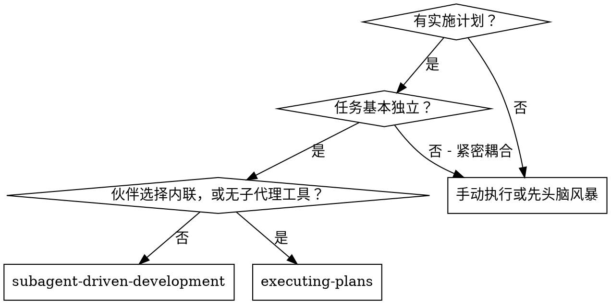
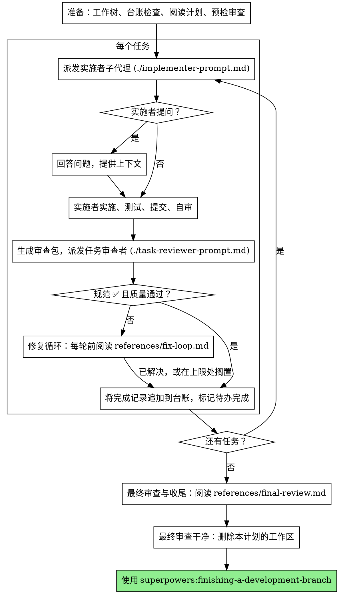

# 子代理驱动开发

通过为每个任务派发一个全新的实施者子代理、每个任务后做一次任务审查（规范符合性 + 代码质量）、最后做一次全分支整体审查来执行计划。

**为什么用子代理：** 你把任务委派给具有隔离上下文的专用代理。通过精心设计其指令和上下文，确保它们保持专注并成功完成任务。它们绝不应继承你会话的上下文或历史——你精确构建它们所需的一切。这也为你保留了用于协调工作的上下文。

**核心原则：** 每个任务一个全新子代理 + 任务审查（规范 + 质量）+ 整体最终审查 = 高质量、快速迭代

**叙述：** 工具调用之间，最多叙述一行短句——台账和工具结果承载记录。

**连续执行：** 任务之间不要暂停与人类伙伴确认。不间断执行计划中的所有任务。停止的唯一理由是下文列出的四种情况，或所有任务完成。"我应该继续吗？"之类的提示和进度摘要是在浪费他们的时间——他们让你执行计划，那就执行。

**裁决，而非停滞。** 运行中的计划不等待人类。冲突、歧义、计划缺陷、你本想申请突破的上限——都由你决定。规范是约束性权威，计划是其论证，你的判断裁定两者都未回答的问题。将每个决定记入台账：`Ruling: <你决定了什么> — <为什么> — <如果错了代价是什么>`，然后继续。一个错误裁决的代价是人类伙伴看得见、可撤销的返工；一个因问题而停摆的会话代价是他们一整天，且毫无收获。

只有四件事能让你停下：不可逆或破坏性操作；安全敏感操作；本工作树之外、按惯例应先询问的副作用（合并、推送到共享分支、发布）；以及计划严重损坏到每条前进路径都是猜测。遇到这些，停下并询问。

## 何时使用

**对比执行计划（内联）：**
- 每个任务一个全新子代理（无上下文污染），而非一个上下文做所有任务
- 每个任务后审查（规范符合性 + 代码质量），而非仅在最后审查
- 每个任务和每次审查各消耗一个全新上下文；内联消耗一个上下文加一个最终审查者
- 两者都在本会话中运行，共享同一计划工作区和台账，且任务之间从不暂停

## 流程

## 准备

确保工作在隔离工作区中进行：使用 superpowers:using-git-worktrees 创建一个或验证现有工作区。未经人类伙伴明确同意，绝不在 main/master 分支上开始实施。

对话记忆无法在压缩后存活。在真实会话中，失去位置的控制器曾重新派发整个已完成的任务序列——这是观察到的最昂贵的单一失败。在台账文件中跟踪进度，而不仅是在待办中。

- 每个计划拥有一个工作区：技能启动时，运行本技能的 `bash scripts/sdd-workspace PLAN_FILE`——它打印该计划的 git 忽略目录（位于 `<repo-root>/.superpowers/sdd/` 下），是本计划所有产物的存放处：台账、任务简报、报告、审查包。另一个计划的目录永远不归你读写。
- 检查本计划的台账是否位于 `<workspace>/progress.md`。如果存在，先阅读 [references/resuming.md](references/resuming.md)：它说明这是谁的台账以及从哪里恢复。
- 创建台账，第一行为其身份标识：`# SDD ledger — plan: <plan file path>`。
- 台账是你的恢复地图：它记录的提交存在于 git 中，即使你的上下文已不记得创建过它们。压缩后，信任台账和 `git log` 而非你自己的回忆。
- `git clean -fdx` 会销毁工作区（它是 git 忽略的临时目录）；如果发生，从 `git log` 恢复。

阅读一次计划，记下其上下文和全局约束，为每个任务创建一个待办。如果计划指定了规范，也阅读它：规范是计划论证所依据的权威，计划内部的冲突以规范为准。没有可访问规范的计划要在台账中注明——没有规范时做出的裁决是临时的。

在派发任务 1 之前，阅读 [references/preflight.md](references/preflight.md) 并运行其描述的冲突扫描。其表格和裁决记入台账。

## 模型选择

使用能胜任每个角色的最弱模型，以节省成本并提高速度。

**机械性实施任务**（隔离函数、清晰规范、1-2 个文件）：使用快速、廉价的模型。当计划规定得当时，大多数实施任务是机械性的。

**集成与判断任务**（多文件协调、模式匹配、调试）：使用标准模型。

**架构与设计任务**：使用可用的最强模型。最终全分支审查就是其中之一——用可用的最强模型派发，而非会话默认模型。

**审查任务**：用同样的判断选择模型，按差异的大小、复杂度和风险缩放。小的机械性差异不需要最强模型；微妙的并发变更则需要。小修复差异的限定范围复审使用廉价到中档模型。

**修复循环升级（第 4-5 轮）**：使用至少比卡住的实施者高一档的模型。

**派发子代理时始终明确指定模型。** 省略模型会继承你会话的模型——通常是最强也最昂贵的——这会悄悄抵消本节的效果。

**轮次数量胜过 token 价格。** 实际耗时和上下文成本随子代理的轮次数量增长，而最廉价的模型在多步工作上通常需要 2-3 倍的轮次——总体成本更高。将中档模型作为审查者和依据散文描述工作的实施者的下限。当任务的计划文本包含要编写的完整代码时，实施就是转录加测试：为该实施者使用最廉价档。单文件机械性修复也使用最廉价档。

**任务复杂度信号（实施任务）：**
- 涉及 1-2 个文件且有完整规范 → 廉价模型
- 涉及多个文件且有集成问题 → 标准模型
- 需要设计判断或广泛的代码库理解 → 最强模型

## 任务循环

**小的同形工作：** 当计划列出跨文件的若干同类小编辑时，在派发它们之前阅读 [references/batching.md](references/batching.md)。

你粘贴进派发提示的一切——以及子代理打印回来的一切——都会在会话剩余时间内驻留在你的上下文中，并在之后每一轮被重新读取。以文件形式移交产物。

**等待已派发的子代理：** 绝不用短超时轮询等待接口，也绝不陷入一次静默、无界的等待。当你有本地工作时——更新台账、打包下一次审查、阅读报告——继续工作；子结果会自行到达。当你确实空闲时，以有界时段等待（五到十分钟，视平台允许），时段之间发布一行状态并核对活跃子代理：列出它们，追查任何已完成但未报告的。有界时段保留了长等待几乎全部的效率，同时保证卡住或丢失的子代理在几分钟内被发现，而非会话结束时。

### 1. 派发实施者

派发前记录 BASE（`git rev-parse HEAD`）——审查包和修复轮差异需要它。

- **任务简报：** 派发实施者之前，运行本技能的 `bash scripts/task-brief PLAN_FILE N`——它将任务的完整文本提取到唯一命名的文件并打印路径。组织派发内容，使简报成为需求的唯一来源。你的派发应包含：(1) 一行说明此任务在项目中的位置；(2) 简报路径，以"先读这个——这是你的需求，包含要逐字使用的确切值"引入；(3) 简报无法知晓的、来自早期任务的接口和决定；(4) 你对简报中注意到的任何歧义的解决；(5) 报告文件路径和报告契约。确切值（数字、魔法字符串、签名、测试用例）只出现在简报中。绝不让子代理阅读整个计划文件。
- **报告文件：** 以简报命名实施者的报告文件（简报 `…/task-N-brief.md` → 报告 `…/task-N-report.md`），并将其放入派发提示。实施者在那里写完整报告，只返回状态、提交、一行测试摘要和顾虑。
- 派发提示描述一个任务，而非会话历史。不要把累积的前序任务摘要（"任务 1-3 后的状态"）粘贴进后续派发——一个真实会话的派发达到 42k 字符，其中 99% 是粘贴的历史。全新子代理需要其任务、它涉及的接口和全局约束。仅此而已。
- 派发携带无子代理契约（在实施者模板中）：实施者绝不派发子代理——不派发助手，绝不派发审查者。审查在你收到报告后由你送达。在真实会话中，工作者派生的每个审查者都重复了控制器无论如何都会派发的任务审查——每个任务多出一个完整审查席位。
- 如果早期任务在此任务涉及的领域搁置了发现，在派发中携带指向该台账条目的指针。
- 从派发结果记录实施者的代理身份——修复循环第 1-3 轮恢复此代理。
- 绝不要并行派发多个实施子代理（冲突）。

模板：[implementer-prompt.md](implementer-prompt.md)

### 2. 处理报告

实施者子代理报告四种状态之一。分别妥善处理：

**DONE：** 生成审查包（`bash scripts/review-package PLAN_FILE BASE HEAD`，从本技能目录运行——它打印所写入的唯一文件路径；BASE 是你派发实施者前记录的提交——绝不用 `HEAD~1`，那会悄悄丢弃多提交任务中除最后一个之外的所有提交），然后用打印的路径派发任务审查者。

**任何其他状态**（DONE_WITH_CONCERNS、NEEDS_CONTEXT、BLOCKED）：阅读 [references/handling-reports.md](references/handling-reports.md) 并遵循它，每次收到都如此。

如果实施者提问——开始前或任务中——清晰完整地回答，必要时提供额外上下文，不要催促它进入实施。

### 3. 审查任务

每任务审查是任务范围的关卡。整体审查在最终全分支审查时进行一次。绝不跳过任务审查，绝不接受缺少任一裁决的报告——规范符合性和任务质量都必需。实施者自审绝不替代任务审查；两者都需要。

- 以文件形式将差异交给审查者：运行本技能的 `bash scripts/review-package PLAN_FILE BASE HEAD`，将打印的文件路径传给审查者（或无 bash 时：对该范围运行 `git log --oneline`、`git diff --stat` 和 `git diff -U10`，重定向到一个唯一命名的文件）。输出绝不进入你自己的上下文，审查者一次 Read 调用即可看到提交列表、统计摘要和带上下文的完整差异。使用你派发实施者前记录的 BASE——绝不用 `HEAD~1`，那会悄悄截断多提交任务。绝不在没有差异文件的情况下派发任务审查者。
- **审查者输入：** 任务审查者获得三个路径——同一简报文件、报告文件和审查包——加上约束任务的全局约束。
- 你交给审查者的全局约束块是其注意力透镜。从计划的全局约束部分或规范逐字复制约束性要求：确切值、确切格式，以及组件之间的既定关系（"与 X 相同的布局"、"匹配 Y"）。审查者模板已携带流程规则（YAGNI、测试卫生、审查方法）——约束块用于本项目的规范所要求的内容。
- 不要添加开放式指令，如"检查所有使用"或"如有用则运行竞态测试"，除非有具体、任务特定的理由
- 不要要求审查者重新运行实施者已在同一代码上运行过的测试——实施者的报告携带测试证据
- 不要为审查者预判发现——绝不指示审查者忽略或不标记特定问题。如果你认为某发现会是误报，让审查者提出并在审查循环中裁定。如果你正在写的提示包含"不要标记"、"不要把 X 视为缺陷"、"最多 Minor"或"计划选择了"——停下：你在预判，通常是为了给自己省一次审查循环。
如果审查者报告"⚠️ 无法从差异验证"项，在标记任务完成前阅读 [references/cannot-verify.md](references/cannot-verify.md)。

模板：[task-reviewer-prompt.md](task-reviewer-prompt.md)

### 4. 修复循环

当审查报告规范 ❌、任何 Critical 或 Important 发现，或你确认为真实缺口的 ⚠️ 项时，循环触发。

触发时，阅读 [references/fix-loop.md](references/fix-loop.md) 并遵循它。每轮前再读一次，即使你本会话早先读过：它包含轮次上限、熔断器以及每轮写入的台账行，而你对它的记忆无法在压缩后存活。

### 5. 完成任务

当审查干净返回——或每个未决发现都在上限处带裁决搁置——在与其他簿记相同的消息中将完成行追加到台账：

- `Task <N>: complete (commits <base7>..<head7>, review clean)`
- 熔断器触发后：`Task <N>: complete (commits <base7>..<head7>, <K> parked)`

然后标记待办完成并继续。当审查有未修复也未在上限处带裁决搁置的未决 Critical/Important 问题时，绝不进入下一任务。

## 最终审查

当所有任务完成时，阅读 [references/final-review.md](references/final-review.md) 并遵循它。它涵盖全分支审查、其单次修复波以及如何收尾。

## 常见合理化

| 借口 | 现实 |
|--------|---------|
| "规范符合性差不多就行" | 审查者发现规范缺口 = 未完成。修复或触及上限并裁决——这是仅有的出口。 |
| "我自己修，派发是开销" | 控制器修复污染你的上下文并跳过审查。恢复实施者。 |
| "再来一轮就会收敛" | 超过上限后，轮次不会收敛——失败是结构性的。裁决并路由。 |
| "审查者反正会找到新东西" | 限定范围复审验证修复；它们无法游荡。未触及代码上的新发现进台账，不进循环。 |
| "这个发现明显错了，我丢掉它" | 你只在上限处裁决，且每个裁决都是台账条目。禁止静默丢弃。 |
| "修复很小，跳过复审" | 未经审查的修复是回归落地的方式。每轮都以限定范围复审结束。 |
| "审查拖慢循环" | 没有审查的循环只是未经验证的瞎忙。审查是循环的刹车和转向。 |
| "