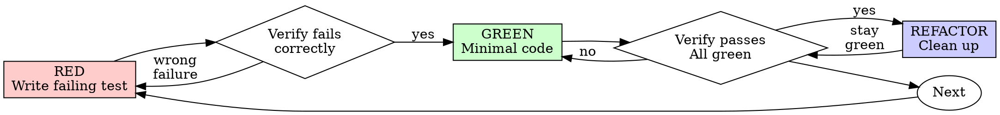

# 测试驱动开发（TDD）

## 概述

先写测试。看它失败。写最少代码让它通过。

**核心原则：** 如果你没亲眼看到测试失败，你就不知道它测的是不是正确的东西。

**违反规则的字面就是违反规则的精神。**

## 何时使用

**始终：**
- 新功能
- 缺陷修复
- 重构
- 行为变更

**例外（先问你的搭档）：**
- 一次性原型
- 生成的代码
- 配置文件

想着"就这一次跳过 TDD"？停下。那是合理化。

## 铁律

```
没有失败的测试，就不写生产代码
```

先写代码后写测试？删掉。重来。

**没有例外：**
- 不要留作"参考"
- 不要在写测试时"改造"它
- 不要看它
- 删就是删

从测试重新实现。就这样。

## 红-绿-重构



### 红 - 写失败的测试

写一个最小测试，展示应该发生什么。

<Good>
```typescript
test('retries failed operations 3 times', async () => {
  let attempts = 0;
  const operation = () => {
    attempts++;
    if (attempts < 3) throw new Error('fail');
    return 'success';
  };

  const result = await retryOperation(operation);

  expect(result).toBe('success');
  expect(attempts).toBe(3);
});
```
名称清晰，测试真实行为，只测一件事
</Good>

<Bad>
```typescript
test('retry works', async () => {
  const mock = jest.fn()
    .mockRejectedValueOnce(new Error())
    .mockRejectedValueOnce(new Error())
    .mockResolvedValueOnce('success');
  await retryOperation(mock);
  expect(mock).toHaveBeenCalledTimes(3);
});
```
名称含糊，测的是 mock 而不是代码
</Bad>

**要求：**
- 一个行为
- 名称清晰
- 真实代码（除非不可避免，否则不用 mock）

### 验证红 - 看它失败

**强制。绝不跳过。**

```bash
npm test path/to/test.test.ts
```

确认：
- 测试失败（不是报错）
- 失败信息符合预期
- 失败原因是功能缺失（不是拼写错误）

**测试通过了？** 你测的是已有行为。修正测试。

**测试报错了？** 修正错误，重跑直到它正确失败。

### 绿 - 最少代码

写最简单的代码让测试通过。

<Good>
```typescript
async function retryOperation<T>(fn: () => Promise<T>): Promise<T> {
  for (let i = 0; i < 3; i++) {
    try {
      return await fn();
    } catch (e) {
      if (i === 2) throw e;
    }
  }
  throw new Error('unreachable');
}
```
刚好够通过
</Good>

<Bad>
```typescript
async function retryOperation<T>(
  fn: () => Promise<T>,
  options?: {
    maxRetries?: number;
    backoff?: 'linear' | 'exponential';
    onRetry?: (attempt: number) => void;
  }
): Promise<T> {
  // YAGNI
}
```
过度设计
</Bad>

不要加功能、重构其他代码，或超出测试去"改进"。

### 验证绿 - 看它通过

**强制。**

```bash
npm test path/to/test.test.ts
```

确认：
- 测试通过
- 其他测试仍然通过
- 输出干净（无错误、警告）

**测试失败？** 改代码，不是改测试。

**其他测试失败？** 立即修复。

**"其他测试"指整个项目的测试套件，不只是你的文件。** 你写的测试单独跑绿不等于套件绿。在宣布完成前，运行项目的测试命令（裸 `pytest`、`npm test`、`cargo test`——仓库用什么就用什么），即使你的任务只点名了一个测试文件。任务里的范围说明限定的是交付物，不是你的验证范围。那次运行暴露的任何失败——包括不是你造成的——都要在报告中点名列出；你看着滚过去却没提的红色测试，就是因遗漏而失实的报告。

### 重构 - 清理

只在绿之后：
- 消除重复
- 改进命名
- 提取辅助函数

保持测试绿。不要加行为。

### 重复

为下一个功能写下一个失败测试。

## 好的测试

| 质量 | 好 | 坏 |
|---------|------|-----|
| **最小** | 一件事。名称里有"和"？拆开。 | `test('validates email and domain and whitespace')` |
| **清晰** | 名称描述行为 | `test('test1')` |
| **体现意图** | 展示期望的 API | 掩盖代码该做什么 |

写或改任何测试时，阅读 [writing-good-tests.md](writing-good-tests.md) 了解让测试保持诚实的规则：
- 写测试前，先说出会让它失败的生产代码变更
- 断言真实行为，绝不断言 mock 行为
- 仅测试用的代码放在测试工具里，不要放进生产类
- mock 依赖前先理解它的副作用

## 常见合理化

| 借口 | 现实 |
|--------|---------|
| "太简单不用测" | 简单代码也会坏。测试只要 30 秒。 |
| "我之后补测试" | 后写的测试立即通过——什么也证明不了。它可能测错东西、测实现而非行为，或漏掉你忘了的边界情况。你没看它失败过，就没证明它能抓住缺陷。测试先行强制那次失败。 |
| "后补测试达到同样目标（重精神不重形式）" | 后补测试回答"这做了什么"；测试先行回答"这应该做什么"。后写的测试被你已写的代码带偏——你验证的是记得的情况，不是本会发现的情况。有覆盖率，但没证明测试有效。 |
| "已经手动测过了" | 手动测试是临时的：没记录覆盖了什么，代码变了没法重跑，压力下容易漏情况。"我试的时候没问题" ≠ 全面。自动化测试每次都一样跑。 |
| "删掉 X 小时很浪费" | 沉没成本谬误——那时间反正已经花了。真正的选择：用 TDD 重写（高信心）vs. 留着事后补测试（低信心，很可能有缺陷）。留着不可信的代码才是浪费。 |
| "留作参考，先写测试" | 你会改造它。那就是事后测试。删就是删。 |
| "需要先探索" | 可以。丢掉探索，从 TDD 开始。 |
| "测试难 = 设计不清" | 听测试的。难测 = 难用。 |
| "TDD 会拖慢我" | TDD 就是务实之路：提交前抓缺陷、防回归、让你放心重构。"务实"的捷径意味着在生产环境调试——更慢，不是更快。 |
| "手动测更快" | 手动证明不了边界情况。每次改动你都得重测。 |
| "现有代码没测试" | 你在改进它。给现有代码加测试。 |

## 红旗 - 停下并重来

- 测试前写代码
- 实现后写测试
- 测试立即通过
- 说不清测试为什么失败
- "之后"才加的测试
- 合理化"就这一次"
- "我已经手动测过了"
- "后补测试达到同样目的"
- "重精神不重形式"
- "留作参考"或"改造现有代码"
- "已经花了 X 小时，删掉浪费"
- "TDD 是教条，我在务实"
- "这次不一样因为……"

**所有这些都意味着：删代码。用 TDD 重来。**

## 示例：缺陷修复

**缺陷：** 空邮箱被接受

**红**
```typescript
test('rejects empty email', async () => {
  const result = await submitForm({ email: '' });
  expect(result.error).toBe('Email required');
});
```

**验证红**
```bash
$ npm test
FAIL: expected 'Email required', got undefined
```

**绿**
```typescript
function submitForm(data: FormData) {
  if (!data.email?.trim()) {
    return { error: 'Email required' };
  }
  // ...
}
```

**验证绿**
```bash
$ npm test
PASS
```

**重构**
如需要，为多个字段提取校验逻辑。

## 验证清单

在标记工作完成前：

- [ ] 每个新函数/方法都有测试
- [ ] 实现前亲眼看到每个测试失败
- [ ] 每个测试因预期原因失败（功能缺失，不是拼写错误）
- [ ] 写了最少代码让每个测试通过
- [ ] 所有测试通过
- [ ] 输出干净（无错误、警告）
- [ ] 测试使用真实代码（仅在不可避免时用 mock）
- [ ] 边界情况和错误已覆盖

不能全部勾选？你跳过了 TDD。重来。

## 卡住时

| 问题 | 解决方案 |
|---------|----------|
| 不知道怎么测 | 写出期望的 API。先写断言。问你的搭档。 |
| 测试太复杂 | 设计太复杂。简化接口。 |
| 什么都得 mock | 代码耦合太紧。用依赖注入。 |
| 测试准备太多 | 提取辅助函数。还复杂？简化设计。 |

## 调试集成

发现缺陷？写一个复现它的失败测试。遵循 TDD 循环。测试证明修复并防止回归。

没有测试绝不修缺陷。

## 最终规则

```
生产代码 → 测试已存在且先失败
否则 → 不是 TDD
```

没有搭档的许可，没有例外。