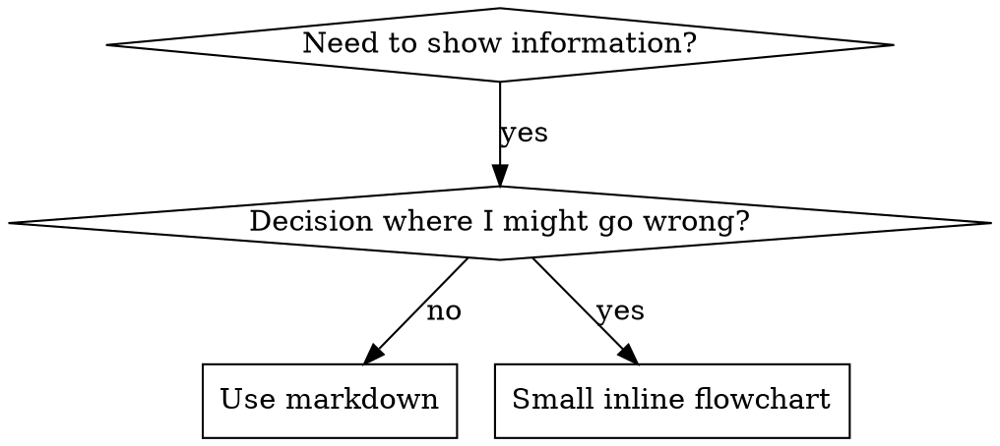

# 技能中的流程图

属于 superpowers:writing-skills 的一部分。

## 流程图用法



**仅在以下情况使用流程图：**
- 不明显的决策点
- 可能过早停止的流程循环
- “何时用 A 而非 B”的决策

**切勿将流程图用于：**
- 参考资料 → 表格、列表
- 代码示例 → Markdown 代码块
- 线性指令 → 编号列表
- 无语义含义的标签（step1、helper2）

graphviz 样式规则见本目录下的 `graphviz-conventions.dot`。

**为你的搭档可视化：** 使用 writing-skills 目录下的 `render-graphs.js` 将技能的流程图渲染为 SVG，在该目录下运行：
```bash
node ./render-graphs.js ../some-skill           # 每个图单独渲染
node ./render-graphs.js ../some-skill --combine # 所有图合并为一个 SVG
```